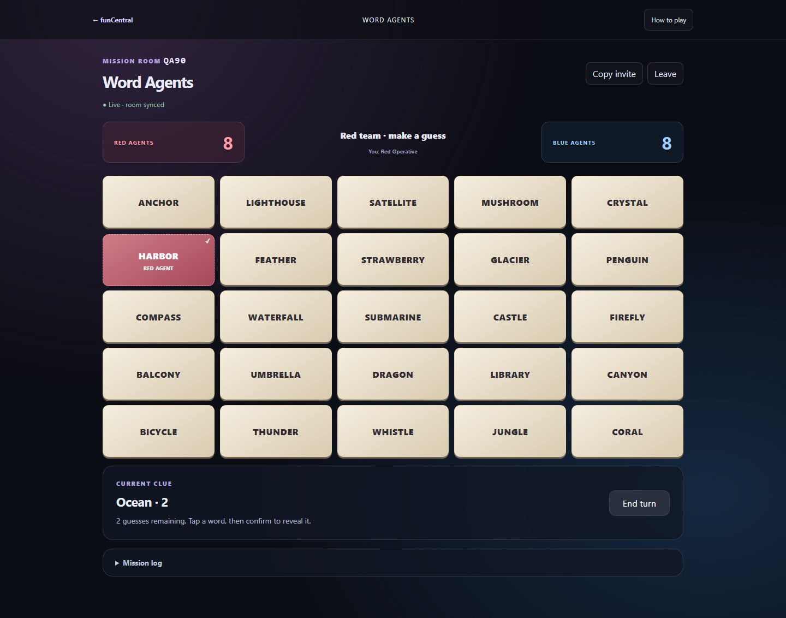
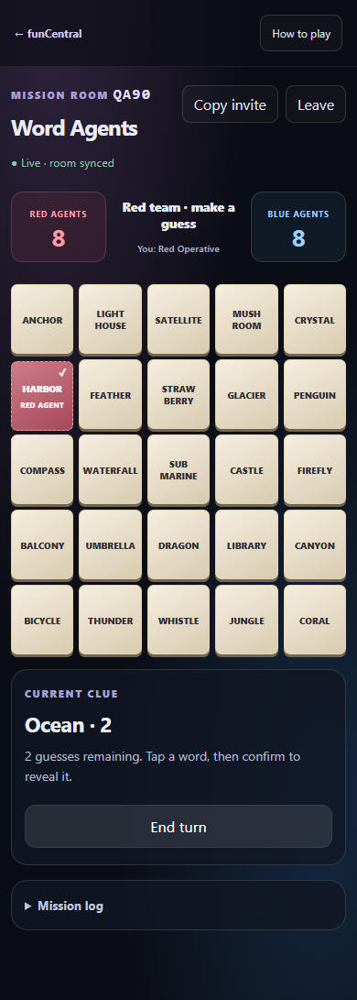
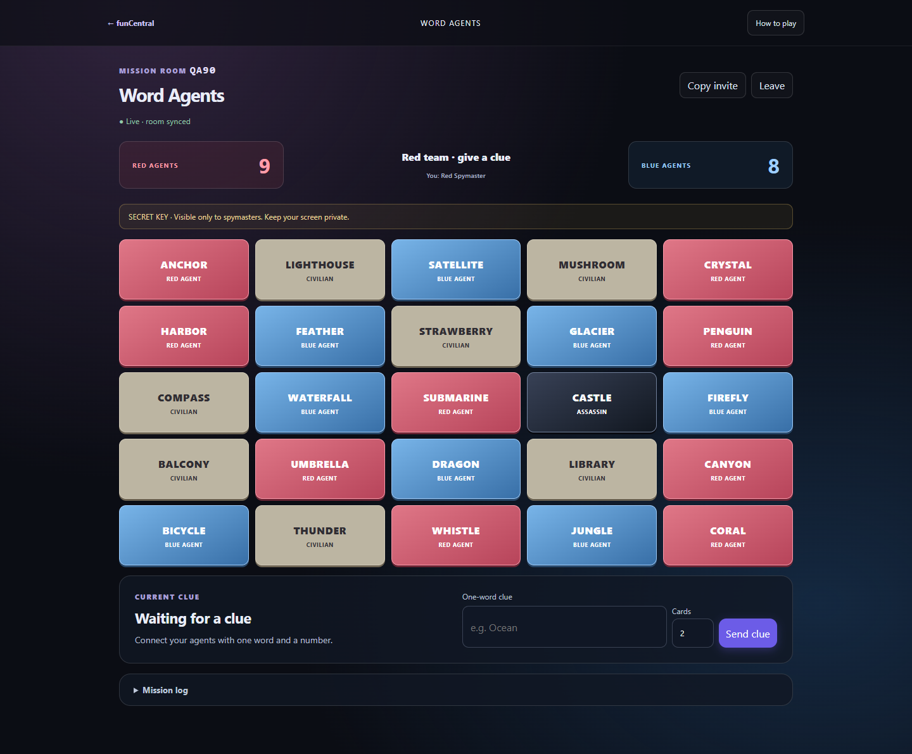
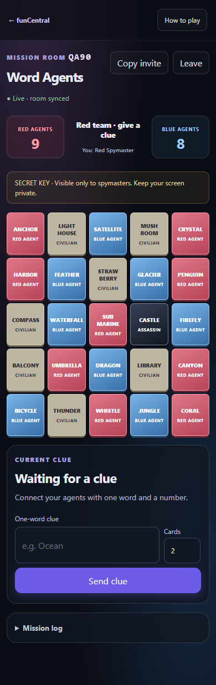
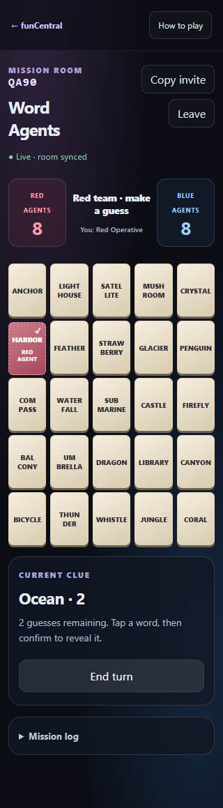
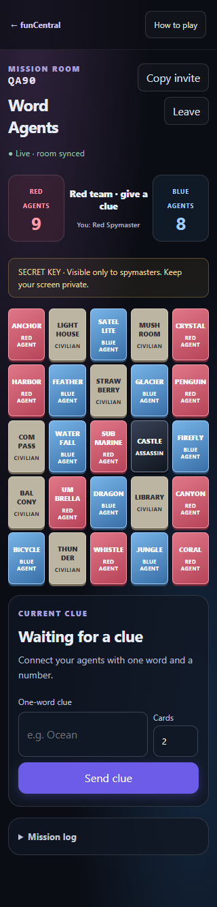
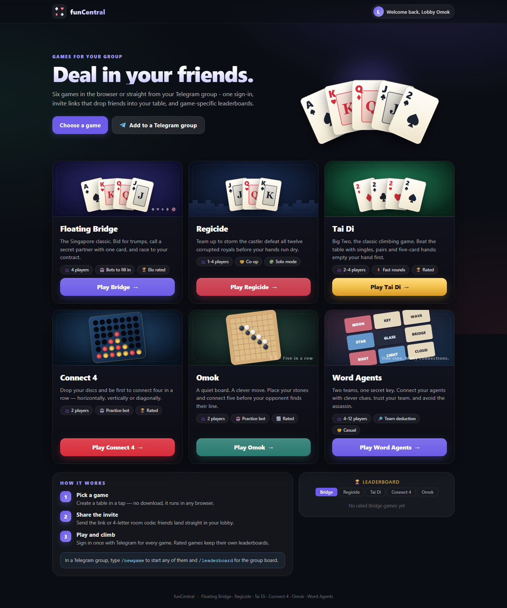

# Word Agents QA — 2026-11-16

PR: https://github.com/vocsong/funCentral/pull/90

Rendered application commit: `577290d182e1ae76db0ca35f7a8ee7cfb311d123`

## Actual screenshots and fixture limits

The 17 Word Agents images are unretouched Chrome screenshots of the local
application at the commit above. Identity, room state and WebSockets are
**fixtures, not live multiplayer**. “Live · room synced” is simulated, and
room QA90, all players and the secret key are synthetic. The additional hub
image uses the real local Worker with a synthetic Dev Login; it is not a
production screenshot. No existing browser tabs or other checkouts were used.

Entry, ready lobby, operative board and spymaster key were captured at desktop
1440×1000 and phone 390×844. Both board roles were also captured at 320×740.
The hub regression capture is 1366×900. Images ending `fullpage` include
content below the viewport; below-fold controls remain reachable by scrolling.
All **18 images were visually inspected**.

## Readable phone labels

The five-column board and existing **9.92px / 850** phone typography are
preserved. Optional `<wbr>` hints let long words wrap at reading boundaries:
LIGHT/HOUSE, STRAW/BERRY, SUB/MARINE and MUSH/ROOM. They add no characters,
change no engine words or rules, and preserve whole-word accessible names.
On desktop the same labels stay on one line. The new full-deck regression
checks every original engine word for both roles at 320px and 390px, including
the longest words, five columns, unchanged spelling, minimum font size,
single-line reading pieces, whole-word names and containment within each card.

| Captured board, each role | Computed text | Words naturally on two lines | Arbitrary breaks / clipping / side overflow |
| --- | --- | --- | --- |
| Desktop, 1440px | 16.32px / 850 | 0/25 | 0 |
| Phone, 390px | 9.92px / 850 | 4/25 | 0 |
| Compact phone, 320px | 9.92px / 850 | 10/25 | 0 |

The four 390px wraps remain LIGHTHOUSE, STRAWBERRY, SUBMARINE and MUSHROOM,
but now use natural chunks rather than orphan letters. At 320px more words
use the same reading hints. No global font-size reduction was made.

## Six games, five ranked tabs

Hub and Telegram assertions now name all six games. The desktop hub's former
five-game centering override was removed, giving six tiles in two rows of
three. The existing five ranked leaderboard tabs remain checked and unchanged:
Word Agents is casual and unranked.

The Telegram chooser integration does more than count buttons: it selects
each of the six games, checks acknowledgement before creation and the posted
invite, then reads the created room. Word Agents is validated through the
actual `WORDAGENTS_ROOM` binding and its initial room code, empty roster,
host, revision, guest identity and null game. Outbound Telegram calls are
captured locally; nothing is sent to Telegram.

## Validation

Environment: Windows; headless Chrome **157.0.8103.78**; Playwright **1.64.1**;
portable Node **22.23.4**; locked dependencies. Captures use DPR 1 and reduced
motion. Both phone sizes use mobile/touch emulation; operative confirmation
was opened with Playwright `tap()` and cancelled, while desktop uses mouse.

| Check | Passed | Failed | Skipped |
| --- | ---: | ---: | ---: |
| Word Agents browser fixtures | 7 | 0 | 0 |
| Affected hub / Omok / Telegram suite | 19 | 0 | 0 |
| Full Vitest suite, 47 files | 477 | 0 | 0 |
| Complete Chromium browser suite | 266 | 0 | 6 |
| Full 2.5D hand-layout repeat | 57 | 0 | 3 |

Full `npm run test:pr` completed with **exit 0**. Typecheck passed. The six
browser skips and three repeat-stage skips are opt-in capture, font-audit and
recording utilities. The main browser stage took 12.3 minutes; the repeat took
1.2 minutes. Counts above describe separate commands/stages and are not added
as unique test cases.

Commands, with the pinned Node version on PATH:

```powershell
$env:PLAYWRIGHT_CHANNEL = 'chrome'
npm run test:ui -- tests/ui/wordagents-ui.pw.js --reporter=line
npm run test:ui -- tests/ui/connect4-splash.pw.js tests/ui/omok-live.pw.js tests/ui/telegram-live.pw.js --reporter=line
npm run test:pr
```

The capture harness completed ten Word Agents screen/viewport combinations
with no page JavaScript errors, unintended word breaks, horizontally
overflowing controls or sideways document overflow. `capture-metadata.json`
retains per-word reading pieces, line counts, font measurements and geometry.
The complete Library bundle contains all images, the capture harness and logs.

GitNexus indexing, renderer impact analysis and staged change analysis were
run. Renderer impact was HIGH because existing identity/reconnect flows call
it; this was flagged before editing. Changes are limited to card-label markup,
label CSS, the six-tile hub grid and corresponding regressions.

## Representative captures

### Desktop operative — local UI fixture



### Phone operative, 390px — local UI fixture



### Desktop spymaster key — local UI fixture



### Phone spymaster key, 390px — local UI fixture



### Compact operative, 320px — local UI fixture



### Compact spymaster key, 320px — local UI fixture



### Ready lobby — local UI fixture


### Six-game hub — local Worker, synthetic sign-in



## Remaining limits and historical evidence

Automated Chromium mobile emulation is not physical iPhone/Android, Safari or
Telegram WebView testing. Screen-reader, assistive-technology and production
network behavior remain unverified. The Word Agents browser screenshots and
seven browser tests use fixtures; the engine/Durable Object tests and local
Telegram room-creation integration are separate authority evidence, not a
complete live four-person Word Agents browser journey.

The [earlier QA snapshot](https://github.com/vocsong/funCentral/blob/e85bf0abf2e755239e5213701eb1a40f4215576f/docs/wordagents/screenshots/QA.md)
retains the previous captures and findings at its immutable commit. Library
replacements preserve earlier versions. No merge or deployment was performed.
