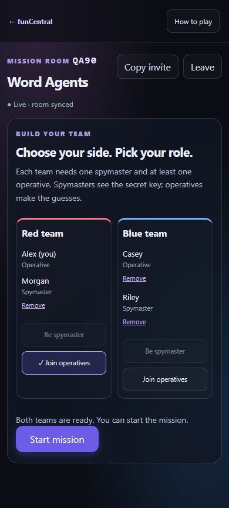

# Word Agents screenshot QA — 2026-11-16

PR: https://github.com/vocsong/funCentral/pull/90

Branch: `feat/word-agents`

Rendered app commit: `81c6fd74b24f3d1699a7b1a133fb391e6c642a47`

**Every screenshot is an actual local browser rendering with fixture identity,
room state and WebSockets. These are not live multiplayer screenshots.**
The branch's HTML, CSS and JavaScript are served unchanged by an isolated
localhost server. The “Live · room synced” status is simulated. Room QA90 and
all four people are synthetic. No Telegram or production service is used.

## Typography result

The approved fix restores the intended card font size and weight. At 390px,
card text computes to **9.92px / 850**, compared with **16px / 400** before
the fix. At 1440px it computes to **16.32px / 850**.

There is a remaining readability concern: **4/25 words still split over two
lines on the phone board**, in both operative and spymaster views:
LIGHTHOUSE, STRAWBERRY, SUBMARINE and MUSHROOM. All four remain visible;
none is clipped or hidden. LIGHTHOUSE and SUBMARINE leave a single trailing
letter on the second line. Desktop has **0/25 split words**. The prior run
had **19/25 split words** on phone at commit f578b4a.

Thus the font override regression is fixed and the board is substantially
improved, but these captures are **not a claim that every phone word fits on
one line**. This screenshot task made no additional app-code changes.

| View | Card font | Words split over lines | Horizontal overflow |
| --- | --- | --- | --- |
| Desktop operative / spymaster, 1440px | 16.32px / 850 | 0/25 each | None |
| Phone operative / spymaster, 390px | 9.92px / 850 | 4/25 each | None |

## Checks

- Focused command: `PLAYWRIGHT_CHANNEL=chrome npm run test:ui -- tests/ui/wordagents-ui.pw.js --reporter=line` (PowerShell environment assignment).
- **5 passed, 0 failed, 0 skipped**, including the new mobile font-size/weight
  regression. Other cases cover stale/cancelled guess confirmation,
  spymaster key and guess lock, disconnect/rules, and watcher join.
- Capture harness: all eight screen/viewport combinations rendered; no
  page JavaScript errors, sideways document overflow or horizontally
  overflowing controls. Operative confirmation opened and cancelled via
  mouse on desktop and Playwright `tap()` on phone.
- All **13 PNGs were visually inspected**. Entry, ready lobby, operative board
  and spymaster key were captured at both widths, with full-page variants
  for content below the initial viewport. Full-page captures do not mean
  all controls fit above the fold.
- `PLAYWRIGHT_CHANNEL=chrome npm run test:pr` unrestricted retry: **exit 1**.
  Typecheck passed. Vitest: **477 passed, 0 failed, 0 skipped**, all 47 files
  passed. Complete Chromium browser stage: **256 passed, 8 failed, 6 skipped**
  out of 270 cases (13.3 minutes), including all five Word Agents cases passing.
  This is **not a passing full PR check**.
- All eight browser failures are stale catalog expectations after adding
  Word Agents as the sixth game: five viewport cases in
  `tests/ui/connect4-splash.pw.js:49` expect “Five games” but receive “Six games”;
  two cases in `tests/ui/omok-live.pw.js:192` expect five `.game-tile` elements
  but receive six; `tests/ui/telegram-live.pw.js:95` expects five chooser
  callbacks but receives the additional `newgame:wordagents` option. These
  assertions were left unchanged under the screenshot/typography task scope.
  The six skipped cases are opt-in capture/audit/recording utilities, as named
  in the retained log. Eight failure contexts and traces are retained in the
  complete bundle.
- The PR runner stopped before its final 2.5D hand-layout stage because of
  those browser failures. That stage was completed separately with
  `HAND_TABLE_VIEW=25d PLAYWRIGHT_CHANNEL=chrome node node_modules/@playwright/test/cli.js test tests/ui/hand-layout.pw.js --output ../wordagents-qa/hand-25d-test-results`:
  **57 passed, 0 failed, 3 skipped** out of 60 cases (1.2 minutes). The three
  skipped cases are opt-in font audit, screenshot and recording utilities.
- Initial sandboxed `npm run test:pr` attempt passed typecheck, then esbuild
  was blocked from reading ancestor directories. Vitest reported 404 passed,
  30 failed, 43 skipped across 47 files (31 passed / 16 failed); both browser
  stages were not reached. These were environment failures, not a passing
  PR check. The unrestricted retry is reported separately above.

## Browser and fixture details

- Windows, headless Google Chrome **157.0.8103.78**, Playwright **1.64.1**,
  portable Node **22.23.4**, locked dependencies from `npm ci --include=dev`.
- Desktop: **1440×1000 CSS px**, DPR 1, mouse input.
- Phone: **390×844 CSS px**, DPR 1, mobile/touch emulation; not a physical phone.
- Reduced motion enabled for capture stability. Fresh isolated browser
  contexts/profile and an ephemeral localhost server were disposed afterward.
  Existing browser tabs and other checkouts were untouched.
- Actual words from the engine's original list are rendered, including
  LIGHTHOUSE, STRAWBERRY and SUBMARINE, rather than WORD0 placeholders.
- Ready lobby: Alex (host/red operative), Morgan (red spymaster), Casey
  (blue operative) and Riley (blue spymaster).
- Operative board: OCEAN 2, one revealed red HARBOR, eight agents remaining
  for each team; unrevealed identities are masked.
- Spymaster board: red clue phase, nine red / eight blue / seven civilian /
  one assassin; Alex is the red spymaster and Morgan is an operative.
  The displayed secret key is synthetic.

## Representative screenshots

These five images are included in the PR branch. The complete Library bundle
contains all 13 captures plus the capture harness, geometry/typography JSON
and test logs. Names ending `fullpage` include content below the viewport.

### Desktop operative — local UI fixture

### Phone operative — local UI fixture, four longer words wrap

### Desktop spymaster key — local UI fixture

### Phone spymaster key — local UI fixture, four longer words wrap

### Phone ready lobby — local UI fixture

## Limits and provenance

These screenshots establish fixture rendering only. They do not establish live
multiplayer/Worker authority, production networking, Safari, physical
iPhone/Android, Telegram WebView, screen-reader or assistive-technology
coverage. Automated live tests in the full PR runner are separate evidence.

The report records this dated run. Library replacements retain the previous
screenshots and report in version history. No deploy or merge was performed.
Only screenshot evidence and this report are added by this QA task.
