# Word Agents UI QA — 2026-11-16

PR: https://github.com/vocsong/funCentral/pull/90

## How these were captured

Unretouched Chrome screenshots from `tests/ui/wordagents-capture.cjs`: a real
local Worker and `WordAgentsRoom` Durable Object, five dev-login identities
(Alice/Bob/Cara desktop, Dan and a signed-out watcher on phone emulation) and
real moves driven through the UI. Nothing is patched; the board and starting
team are random. Desktop is 1440×1000 (DPR 1); phone is 390×844 with mobile and
touch emulation (DPR 2); compact is 320×740. Images ending `fullpage` include
content below the viewport. `desktop-hub-local.png` is the earlier hub capture
and is unchanged by this redesign.

| View | Desktop | Phone |
| --- | --- | --- |
| Home (signed in) | 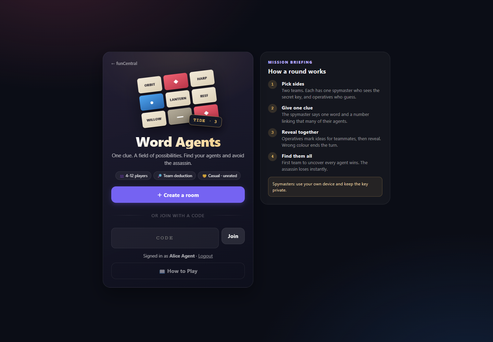 | 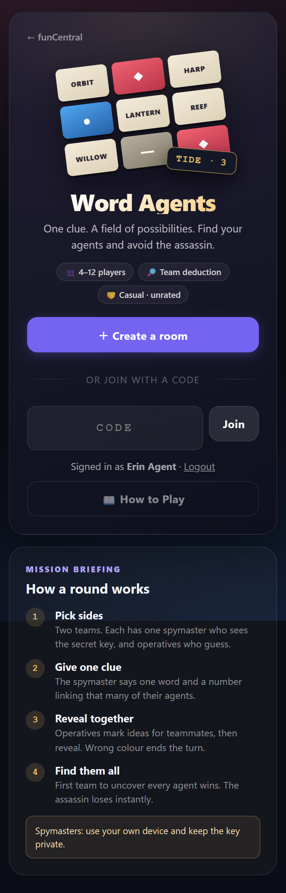 |
| Lobby, both teams ready | 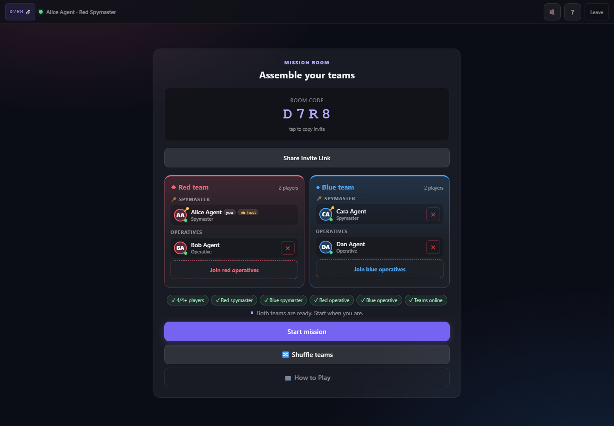 | 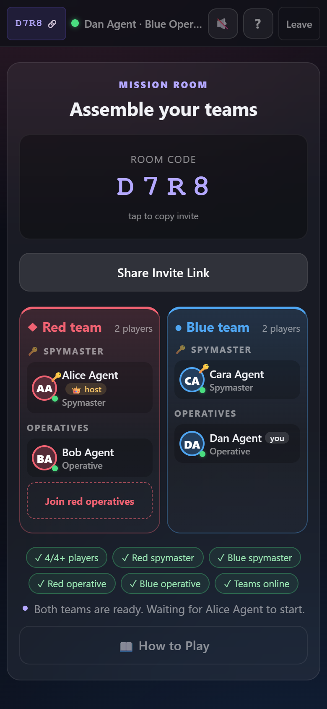 |
| Spymaster giving a clue (full key) | 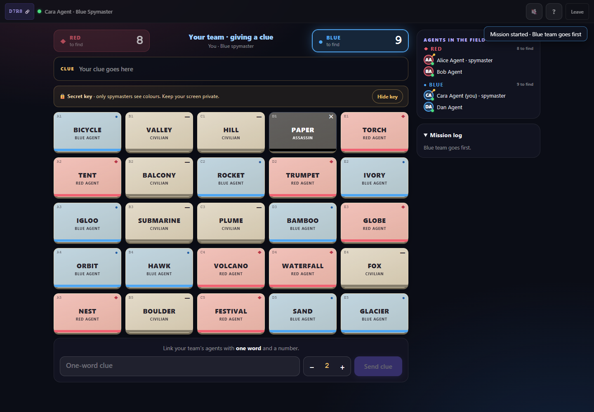 | |
| Operative: one reveal, a shared mark, a selection | 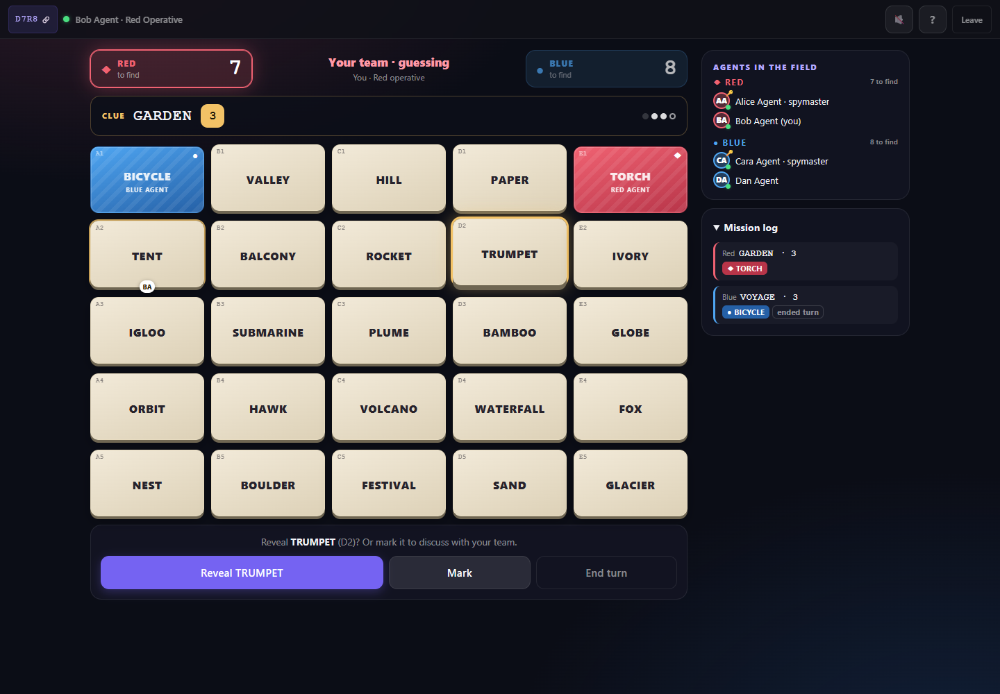 | 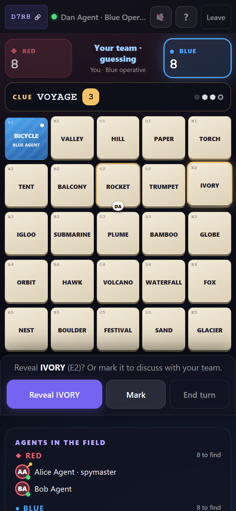 |
| Spymaster watching the guesses | 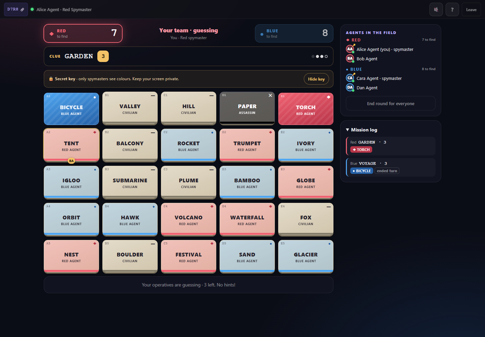 | |
| Results | 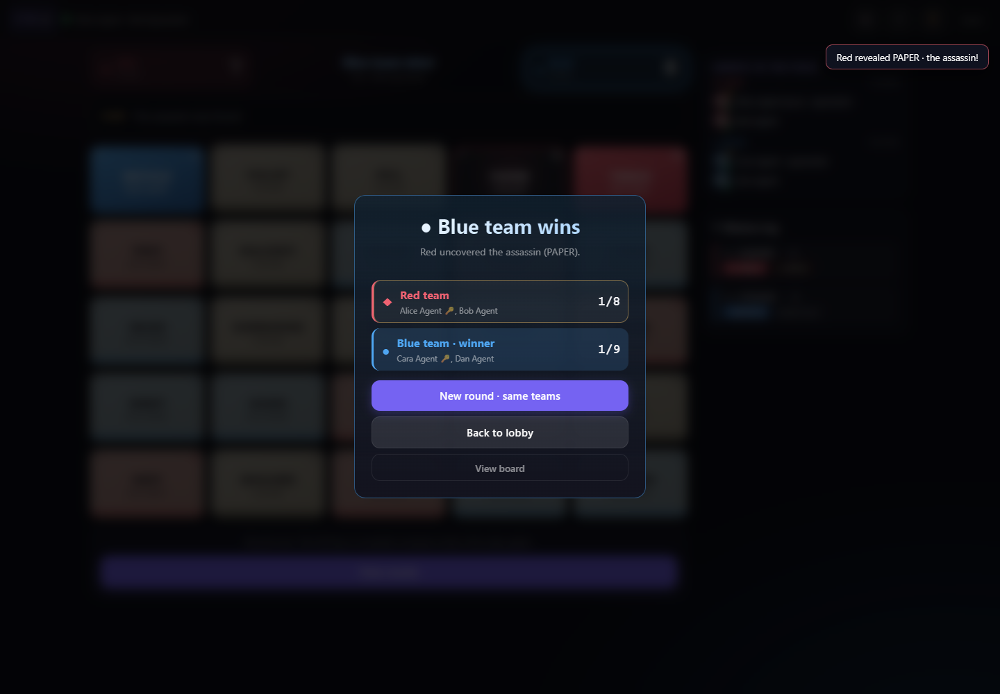 | 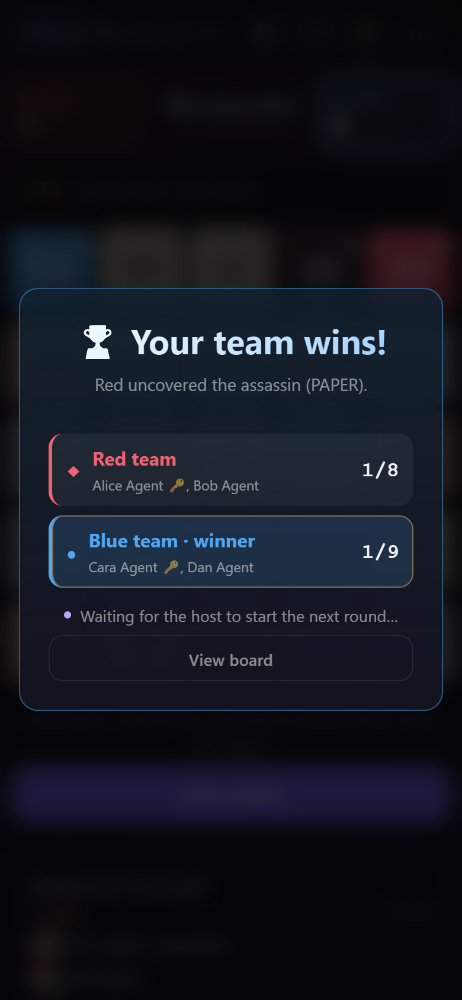 |
| Final board / watcher | 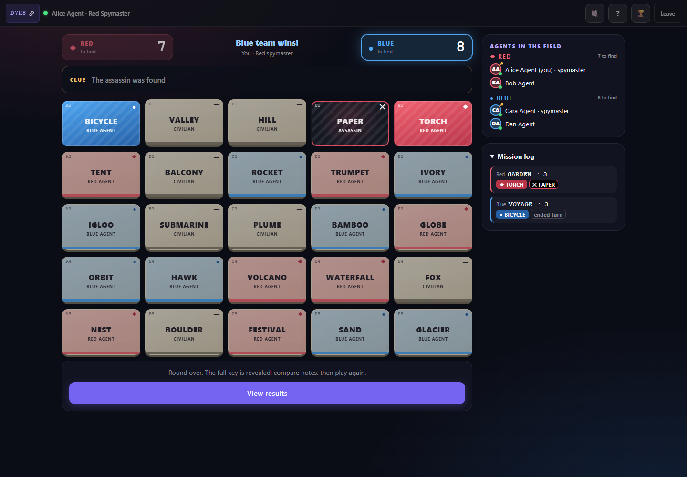 | 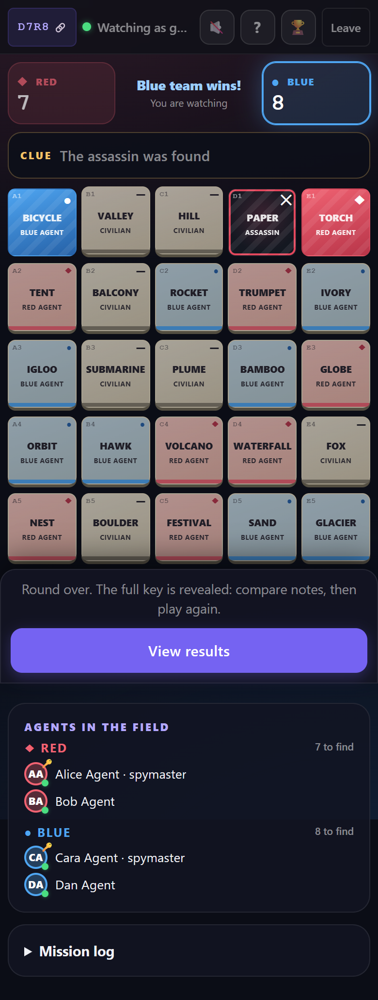 |

Compact 320px operative, full page: 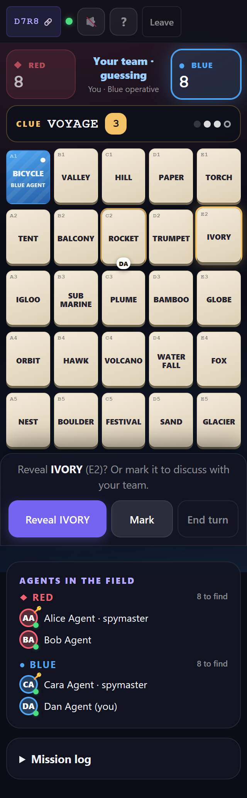

## What was checked by eye

- Five columns at every width with no side overflow; long words wrap only at
  natural reading breaks (STRAW/BERRY, SUB/MARINE).
- Spymaster key tints are distinct from revealed (solid, striped) cards, and
  every colour also has a shape and a text tag.
- Selection (gold ring) and teammate marks (initials) remain visible on hover
  and on touch.
- Event toasts never cover the action dock: on wider screens they appear at
  the top right; on phones briefly at the top, over the scores.
- Results name the winner, the reason and each team's found/total count; only
  the host sees rematch controls.

## Limits

Physical iPhone/Android, Safari, Telegram WebView, screen readers and production
network behaviour remain unverified. Nothing was merged or deployed.
